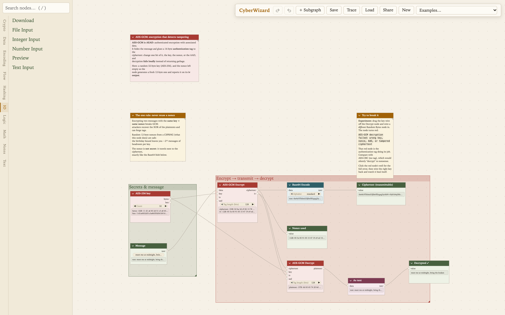
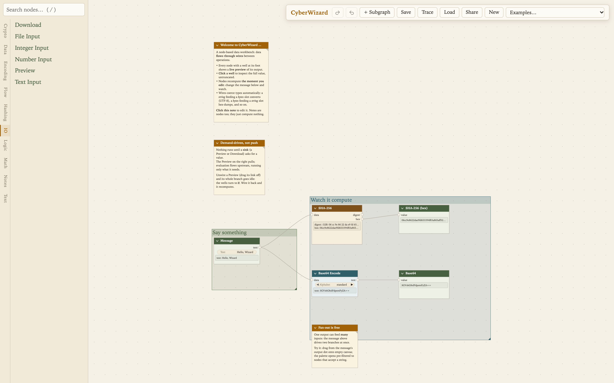
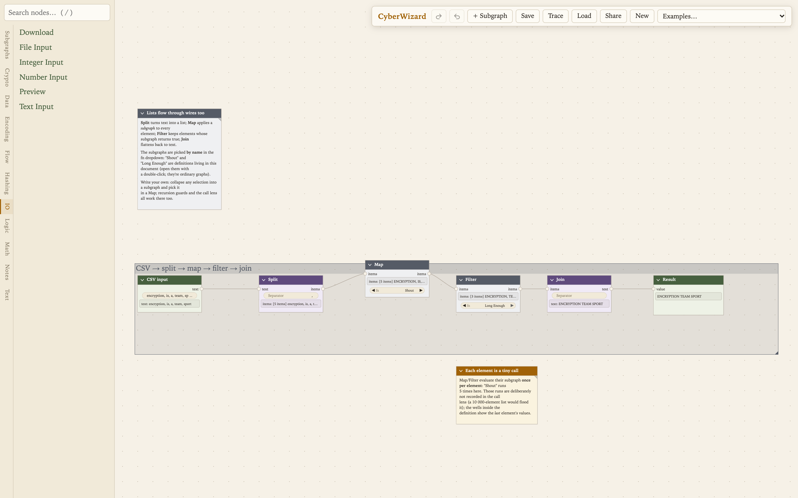
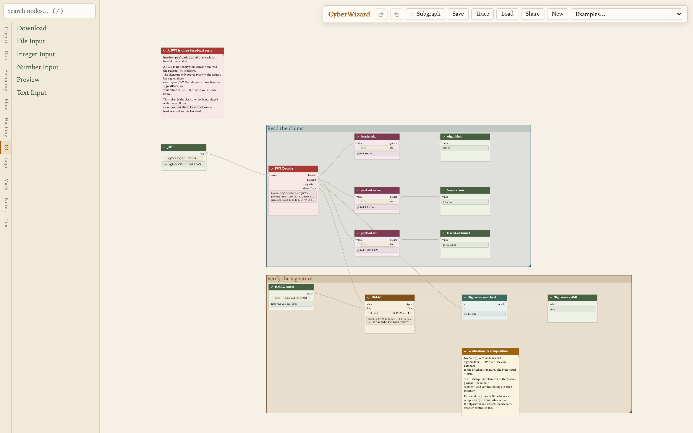

# CyberWizard


A node-based data manipulation workbench for the browser. It covers the same ground as [CyberChef](https://gchq.github.io/CyberChef/), but operations are wired into a graph (LiteGraph) instead of a linear recipe: one input can fan out into parallel transforms, keys and parameters are connections rather than retyped text fields, every intermediate value is inspectable, and any group of nodes can be collapsed into a reusable subgraph.

It is the successor to [CryptoFlow](https://github.com/kkreijkamp/CryptoFlow), my earlier vanilla-JS take on the same idea. Everything runs client-side; no data leaves the browser.



## Develop

```sh
npm install
npm run dev
```

`npm test` (Vitest), `npm run typecheck`, `npm run build` (static bundle in
`dist/`).

## Using the canvas

Add nodes from the palette: double-click or drag one onto the canvas, or press `/` to search and Enter to spawn the first match. Dragging out from a slot filters the palette to type-compatible nodes.

Values are typed (`bytes`, `string`, `number`, `boolean`, `json`, `list<T>`).



Evaluation is demand-driven. Nothing runs unless a sink (Preview, Download) pulls it, and nothing re-runs until its inputs change. Node parameters can be promoted to input slots from the same context menu, which is how you wire a regex or a key in from another node.

## Subgraphs

Subgraphs are reusable nodes defined as graphs, with typed inputs and outputs.

- **Create**: `+ Subgraph` in the header opens an empty definition. Declare inputs/outputs in the sidebar, build the interior, then `Esc` or the breadcrumb bar takes you back up.
- **Collapse**: select nodes, right-click → *Collapse to Subgraph* (`Ctrl/Cmd+G`). The cut edges become the new node's slots.
- **Reuse**: definitions live in the palette under *Subgraphs* and nest freely, including inside themselves. Recursion is depth-limited and budget-capped, so a runaway definition shows a node error instead of freezing the page.
- **Scope**: a definition created inside another definition is local to it - visible only within that subtree and free to share names with helpers in other scopes. Right-click a definition in the palette to move it between scopes. Deleting a definition deletes its local helpers with it.
- **Share**: definitions embed in save files and share URLs; documents are self-contained.

## Lists and conditionals

Lists are first-class values. Alongside the structural ops (Pack, Get, Take/Drop, Append, Reverse, Unique, Sort, Flatten, Zip, Concat, Range) there are three higher-order nodes that apply a subgraph to each element: **Map**, **Filter**, and **Fold** (a 2-in-1-out reduce, `[acc, element] -> acc`).



Two lazy conditionals: **Select** (a ternary on wired values) and **If** (branches are subgraph definitions). Only the taken branch evaluates, which is what recursion bottoms out through: `Fact(n) = Select(n <= 1, 1, n * Fact(n−1))` terminates instead of demanding itself forever.

## Examples

The *Examples* menu in the header loads annotated scenes that walk through the platform and common cryptographic constructions: hashing and the avalanche effect, AES-GCM, password-based encryption, hybrid RSA + AES, Ed25519 signatures, ECDH, JWTs, recursion, and list pipelines.

The largest, *SHA-1 From Scratch*, rebuilds all of SHA-1 out of arithmetic, bit logic, and a tree of scoped helper subgraphs (recursion, Fold, Map, lazy Select), then checks its digest against the built-in SHA-1 node.


